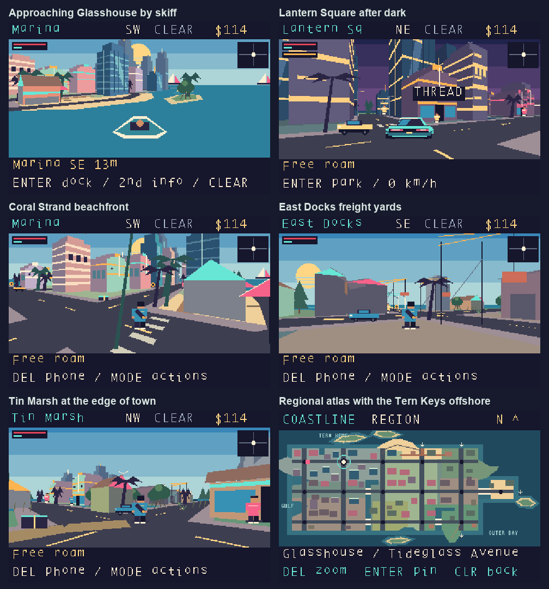

# Last Light / Coastline

An original open-world action-adventure game for the TI-84 Evo. Explore a compact South Florida-inspired city, follow Lena and Sol through a complete story, and take side trips by car, skiff, floatplane, jet ski, or airboat.

## Download and install

Download [Coastline-Evo.zip](Coastline-Evo.zip) and extract it on your computer. Send all ten Python files together to your calculator with [TI Connect Evo](https://connectevo.ti.com/). On the calculator, open **PRGM → Python App**, select **COASTRUN**, and press **Run**.

Read [the play and installation guide](Coastline/PLAY.md) for controls, districts, checkpoint saves, transfer details, and activities. The original Python source files are in [Coastline/](Coastline/).

The game is written in Python for the TI-84 Evo. It uses the built-in ti_draw, ti_system, and time modules. It does not write files or modify calculator variables. The story, map, characters, and artwork are original.
